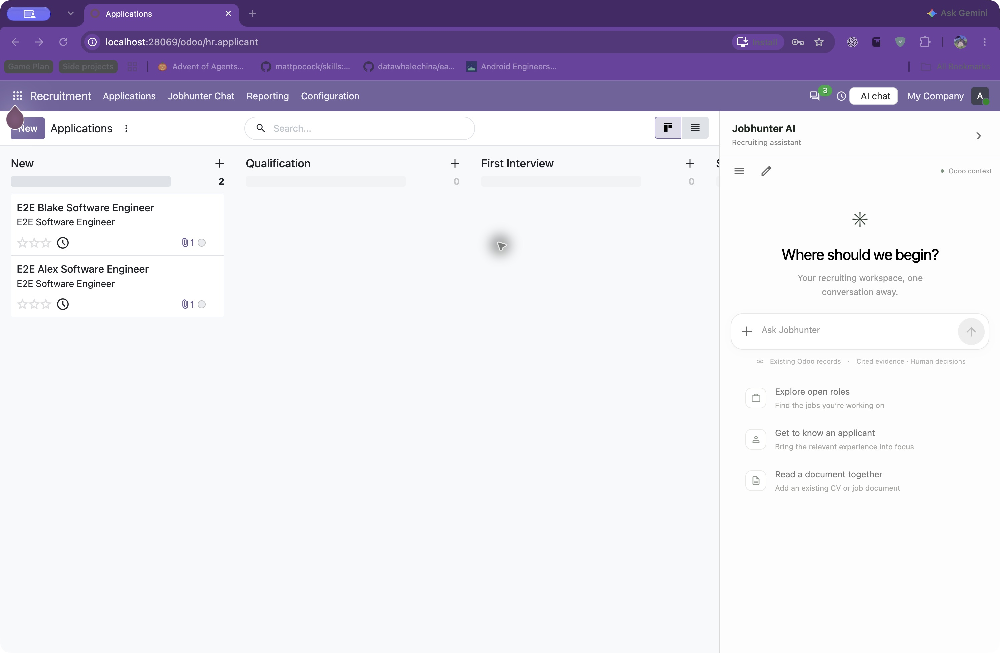

# Jobhunter Chat AI service

## Standalone interview flows

The migrated quick-screening and human-interview assistant remain runnable as an
isolated feature app while the orchestrated Odoo chat service stays unchanged.
Start the API with `PYTHONPATH=backend uvicorn app.standalone:app --port 8000`
and the React/Vite UI with `npm --prefix frontend run dev`. The feature app uses
the `RECRUITER_TOKEN`, provider keys, and interview settings documented in
`.env.example`. This standalone entry point is not yet dispatched by the main
Orchestrator.

Native Odoo Recruitment with a separate **Jobhunter AI** chat panel on the right. The Python orchestrator calls migrated Filter, Interview and Report adapters through the shared Responses gateway. Odoo owns identity, company scope, permissions, source freshness, and private workflow artifacts. This is our own AI layer; it does not route through OdooBot.

The addon is now owned here at `odoo/addons/t10_jobhunter_chat`. Both original RAG addons are copied alongside it as migration references with source revisions/checksums in `odoo/imports.json`; they are not mounted or installed. Active adapted specialists live in `backend/app/agents` and do not rank candidates, score suitability, recommend hiring decisions, change stages, or call legacy recruiting automation.



## Run the local internal app

The repository-owned Compose project uses its own volumes and port **28069**, preserving existing Odoo stacks. It requires the existing `t10-odoo` image. All sample passwords/default secrets below are for this localhost development stack; use private environment values for other environments.

```sh
# Set JOBHUNTER_OPENAI_API_KEY (and optional JOBHUNTER_MODEL) in a private .env.
docker compose up -d --build
# First installation only (or use -u for an existing installation):
docker compose run --rm --no-deps odoo odoo -d jobhunter_e2e -i t10_jobhunter_chat --without-demo=all --stop-after-init --http-port=0
# Optional synthetic recruiter/job/applicant fixtures, only in this isolated DB:
docker compose run --rm --no-deps -T odoo odoo shell -d jobhunter_e2e --no-http < e2e/panel_seed.py
```

Open http://localhost:28069/odoo/action-271 or use **Recruitment → Jobhunter Chat** (the action ID is database-specific; the menu is authoritative). Existing local admin credentials work. Synthetic verification accounts are `workflow.qa1` / `workflow-test-only`.

Use the native application list, kanban, or applicant form on the left. **Use in chat** explicitly selects the current record. Chat stays focused when the native record changes; collapse/reopen preserves the draft and conversation. Resize from 360–640px with the divider or arrow keys; below 900px it becomes a drawer.

Direct typed flow: select applicant → approve criteria → **Review CV** → **Prepare interview** → review five questions → **Create private interview link** → candidate explicitly submits answers and finishes → **Summarize evidence**. No calendar or email is created. Links expire in seven days and can be recovered by the authenticated owner in the originating browser using a saved nonsecret request ID; bearer tokens are not stored in browser storage or sent to agents. Preparing another guide permits a new session. The previous booking API remains compatible, with Schedule unconfigured in this integration.

## Verify adapters and UI

```sh
# Controlled provider responses; the real migrated specialist adapters still run:
docker compose -f docker-compose.yml -f e2e/panel.compose.yml up -d --build
uv run pytest e2e/test_panel.py --tracing retain-on-failure --screenshot only-on-failure
# Separate real-provider smoke, synthetic records only:
docker compose -f docker-compose.yml -f e2e/live.compose.yml up -d --build api
JOBHUNTER_PANEL_PROVIDER_MODE=live JOBHUNTER_PANEL_ARTIFACTS=.state/evidence/panel-live uv run pytest e2e/test_panel.py --tracing retain-on-failure --screenshot only-on-failure
```

The live profile reads the private Compose environment. Never pass provider credentials through browser forms or chat. Evidence and limitations are recorded in `docs/verification-recruitment-panel.md`. The original chat contract and verification history below remain applicable except where the additive workflow contract extends them.

A separate opt-in [Jobhunter Slack pilot](slack_bot/README.md) coordinates HR/tech-lead
interview confirmations and reminders through private DMs. It runs as its own worker
with an isolated database, without using this service's Odoo bridge or APIs.

Requires Python 3.12+, `uv`, PostgreSQL and an internal Odoo bridge. See [shared contract](docs/chat-contract.md) for the exact interface and [approved plan](docs/superpowers/plans/2026-10-31-jobhunter-chat.md) for scope. The [local installation and verification record](docs/verification-2026-10-31.md) distinguishes automated checks from the actual OpenAI/Odoo browser walkthroughs.

```sh
uv sync --frozen
cp .env.example .env
# Set private local credentials and the pinned internal Odoo origin in .env.
PYTHONPATH=backend uv run uvicorn app.main:create_app --factory --host 127.0.0.1 --port 8000 --workers 1 --no-access-log
```

Use one API worker and one service instance per database. The service creates its own tables on first startup; this initial schema has no production migration history yet. It marks queued/running runs interrupted on startup, retains partial drafts and never resumes/retries automatically. Its separate PostgreSQL database must use an application-specific database/user. Production SQLite is rejected. `/health` checks database/configuration without calling OpenAI and reports `degraded` when no provider key is configured.

Provider chunks are staged as internal run drafts until the final answer passes citation/source checks. Public agent/tool activity updates during execution; answer delta/completion events and the verified history message are published atomically at completion. Cancelled, failed and interrupted drafts remain stored internally and are excluded from public history and future model prompts. A Report answer replaces provisional Orchestrator prose.

All `/v1` requests require the shared bridge secret plus the Odoo-derived principal. No browser CORS is configured; Compose should publish no backend port. Capabilities are kept only in active task memory. OpenAI requests use Responses streaming, `store=False`, fixed v1.0 shared/role prompts and zero SDK retries. An evidence run performs a separate tool-free Report call; source-free general chat answers directly. The backend enforces 120 seconds, six provider requests and eight business-tool calls per run.

Record tool output is strictly allowlisted, source references are registered as `[S1]` keys and citations/quotes are checked before delivery. Nonempty record data without sources fails closed. Reused source-derived answers inherit their source dependencies. Odoo revalidates source access/version before tool result reuse, Report delivery and history/event retrieval. Missing/failed validation masks derived text/sources/tool payloads; outdated answers are labeled and excluded from future model prompts. User-authored messages remain visible to their owner. No capability or raw provider error is exposed in public errors/events.

Documents are limited to 10 MiB and extracted as PDF pages, DOCX paragraphs or UTF-8 TXT lines (100,000 characters/200 fragments maximum; truncation explicit). Production parsing uses a separate process with an eight-second timeout, five CPU seconds and a 512 MiB Linux address-space limit. It never follows embedded links or inherits service secrets. Scanned, encrypted, unsupported and unreadable files require user input. Citation checks verify key membership and exact quote/excerpt matches; semantic entailment of arbitrary generated prose remains a model responsibility.

Verification uses synthetic data and deterministic provider/Odoo fakes. The SDK streaming test uses a local mock HTTP transport, without a paid request. The PostgreSQL helper creates an isolated temporary native cluster, runs the whole suite and removes it; it never connects to an existing database.

```sh
uv run pytest -q
# When initdb and pg_ctl are installed:
uv run python backend/scripts/test_with_postgres.py -q
uv run ruff check backend
uv run ruff format --check backend
```

These checks do not establish a live Odoo/OpenAI integration. Run the native addon and explicit live smoke separately using authorized synthetic records and credentials. Nothing in this repository deploys automatically.
