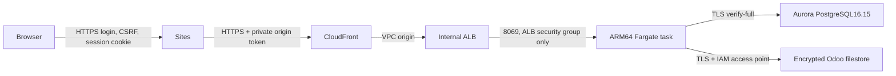

# Jobhunter cloud deployment

The public application uses the Sites hostname `https://jobhunter-workspace.netlink269.chatgpt.site`. AWS account `511825855918`, region `us-east-1`, owns the private upstream. All records are newly created synthetic fixtures. Outgoing SMTP and Odoo cron are disabled.



The task requests 0.5vCPU and2GiB, runs continuously with desired count1, and obtains a public IPv4 solely for outbound access. No NAT gateway is provisioned. Its security group permits inbound8069 only from the internal ALB. The ALB permits inbound80 only from the AWS-created CloudFront VPC-origin service security group. Neither database is publicly accessible. Subnets use `us-east-1a` (`use1-az1`) and `us-east-1b` (`use1-az2`); the writer uses1a.

Inside the task, nginx listens on8069 and passes native HTTP to Odoo8068 and WebSockets to its evented8072 worker. The API binds exclusively to localhost8000. API signed callbacks use Odoo8072, independently of the synchronous worker handling a waiting BFF request. This topology passed the full Filter, typed-interview and Report browser flow using real OpenAI against a disposable TLS PostgreSQL instance. One synchronous worker alone would deadlock the callback path. All nginx access logging is disabled and its error log is `/dev/null` at `crit`, preventing candidate bearer URLs from entering CloudWatch. Odoo request access logging and Uvicorn access logging are disabled.

CloudFront caches nothing and forwards all native methods, query strings, cookies and required WebSocket headers. Its viewer-request Function hashes `X-Jobhunter-Origin-Token`, compares against the configured SHA256, then strips the raw header. Missing or incorrect tokens receive403. Management, legacy database-RPC and development routes are denied at Sites, CloudFront and nginx; Odoo also runs with `list_db=False`, no development flags and a fixed database filter. Native Odoo login and CSRF remain authoritative. The Sites public URL is frozen in `web.base.url`.

## Deploy and private state

Run scripts from the repository root. Required tools are AWS CLI, Docker, Python3.12+, uv and Terraform1.12+. The tested local `t10-odoo` ARM64 image must have configuration digest `sha256:231edfd90498a990dfbe24fbbdd778819e9c55ce67745f8af5b245bb57112c7b`. `publish_images.py` pushes that exact image to private immutable ECR, then builds the runtime from its ECR digest. The application image copies only `t10_jobhunter_chat`; imported RAG addons are excluded. Terraform uses the final runtime digest rather than a mutable tag.

The initial one-time IAM bootstrap uses the authenticated account owner only for IAM user/role/policy setup. Every resource operation runs through the short-lived `jobhunter-deploy` assumed role. The temporary bootstrap permissions are regional and limited to deployment services, the state bucket and named runtime roles. Finalization replaces them with project ARN/tag scopes, restricts PassRole to the app execution/task roles for ECS and backup role for AWS Backup, and attaches an owner-controlled permissions boundary to every runtime role. That boundary prevents workload policies from gaining unrelated access and denies bootstrap/admin/master secrets after initialization. The bootstrap IAM access key is disabled after final verification; deployment session credentials expire, rather than being committed or configured globally.

For a fresh account bootstrap only:

```sh
python3 infra/bootstrap.py
python3 infra/cloud.py python3 infra/prepare.py
python3 infra/cloud.py terraform -chdir=infra/terraform init -reconfigure -backend-config=../../.state/backend.hcl
python3 infra/cloud.py terraform -chdir=infra/terraform apply -var-file=../../.state/terraform.tfvars.json -target=aws_ecr_repository.base -target=aws_ecr_repository.runtime
JOBHUNTER_IMAGE_TAG=publish-UNIQUE-REVISION python3 infra/publish_images.py
python3 infra/deploy.py
python3 infra/harden.py
```

The initial ECR-targeted apply is solely the image-build dependency bootstrap; subsequent applies reconcile the whole graph. `deploy.py` initializes the fresh database before increasing desired count to1. It must not be rerun after hardening: initialization access has intentionally been retired. Set `runtime_boundary_enabled=true` in the private variables after finalization. Future updates use a newly authorized short-lived deployment session, publish an immutable revision, update `.state/terraform.tfvars.json`, and apply the whole configuration. Stop-before-start deployments cause a brief maintenance interruption and avoid running two Odoo tasks against one filestore.

The S3 backend `jobhunter-tfstate-511825855918/jobhunter/terraform.tfstate` uses server-side encryption, TLS-only access, versioning, public-access blocking and native S3 lockfiles. No secret values are Terraform inputs/resources/state: Terraform owns Secrets Manager metadata only. Runtime app credentials/provider configuration, one-time bootstrap credentials, the gateway origin token, and the RDS-managed master secret have separate Secrets Manager records. Raw origin tokens are retained only in Secrets Manager, Sites runtime values and the ignored private handoff. ECS cannot retrieve gateway secrets; the running service cannot retrieve bootstrap/master secrets.

`.state/cloud-private.json` is ignored and mode0600. It includes generated admin/recruiter credentials, `recruiter_login`/`recruiter_password` aliases for the browser runner, public URL and origin token. Never print it or upload it as an artifact. `.state/cloud-outputs.json` contains resource identifiers only. `.state/aws-session.json` contains expiring credentials and is mode0600. `.terraform/`, state files, variable files and plans are ignored under `infra`; `.terraform.lock.hcl` is tracked.

## Data, recovery and verification

Aurora Standard uses one serverless writer with0.5–1ACU, seven-day automated backups/PITR and encryption. Separate non-superuser, no-CREATEDB login roles own `jobhunter_cloud` and `jobhunter`. Both have `pg_trgm` and `unaccent`; SQLAlchemy/asyncpg and Odoo/libpq verify the AWS RDS CA and hostname. Initialization explicitly verifies that a wrong hostname is rejected before creating any records.

EFS encrypts the Odoo filestore at rest and in transit; an IAM access point enforces UID100/GID101. A custom daily AWS Backup plan retains EFS recovery points seven days; the EFS default35-day policy is disabled. Durable Aurora, EFS, backup vault, ECR repositories and secret metadata have Terraform `prevent_destroy`; Aurora additionally has AWS deletion protection. CloudWatch logs retain seven days. Database backup/PITR configuration and a completed backup are distinct from a restore drill; no restore drill is claimed.

A new cloud database contains one generated administrator and two generated synthetic recruiters, each opening native Recruitment Applications with supported `odoobot_state=disabled`. The fixtures match `e2e/panel_seed.py`: Alex has a Python/PostgreSQL synthetic CV, Blake a Java-only synthetic CV, and the role has three explicit criteria. No existing recruiting records are imported. SMTP servers and cron are disabled, with localhost port9 as an additional failed-closed SMTP destination.

Run verification:

```sh
uv run pytest
uv run ruff check infra backend/app backend/tests
node --test infra/tests/test_origin_gate.cjs
python3 infra/cloud.py terraform -chdir=infra/terraform fmt -check
python3 infra/cloud.py terraform -chdir=infra/terraform validate
```

The TLS tests were observed failing before the SSLContext/configuration wiring and passing afterward. The origin-gate tests execute the actual Function source with synthetic values. Disposable production-container browser tests and live AWS/Sites tests are reported separately from unit tests. Review current ECS task/container health, ALB target health, unauthorized origin denial, login/CSRF, actual WebSocket101/pong and a full live-provider synthetic workflow before calling a deployment verified.

## Cost target

The account-wide monthly budget is$100, with actual-cost alerts at80% and100% to the existing owner `netlink269@gmail.com`. Account-wide scope avoids relying on unactivated cost-allocation tags. Alerts do not enforce a hard cap, and AWS may delay billing notifications.

At730hours/month, ARM Fargate compute is approximately$17.02, one task IPv4$3.65, and the ALB base$16.43. Aurora compute is approximately$43.80 at0.5ACU and$87.60 at1ACU. Allow additional storage, I/O, ALB LCUs, EFS/backups, ECR, Secrets Manager, logs and CloudFront traffic. A light-usage estimate near$90–110/month depends on Aurora spending most time near0.5ACU; sustained1ACU exceeds that target. OpenAI, taxes, traffic growth and any unrelated account resources add to the bill. Credits/free-tier discounts are not assumed.

Pricing references checked2026-10-31: [Fargate](https://aws.amazon.com/fargate/pricing/), [Aurora](https://aws.amazon.com/rds/aurora/pricing/), [ALB](https://aws.amazon.com/elasticloadbalancing/pricing/), [public IPv4](https://aws.amazon.com/vpc/pricing/). CloudFront VPC origins currently support WebSockets: [AWS announcement](https://aws.amazon.com/about-aws/whats-new/2026/05/amazon-cloudfront-websockets-vpc-origins/).
